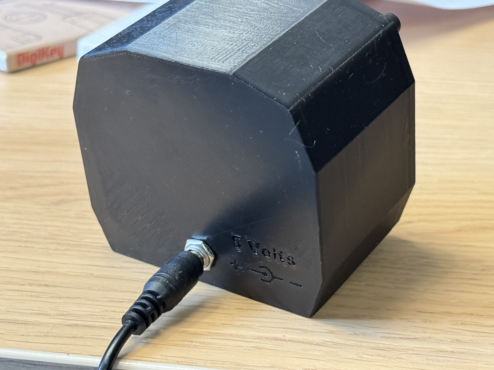
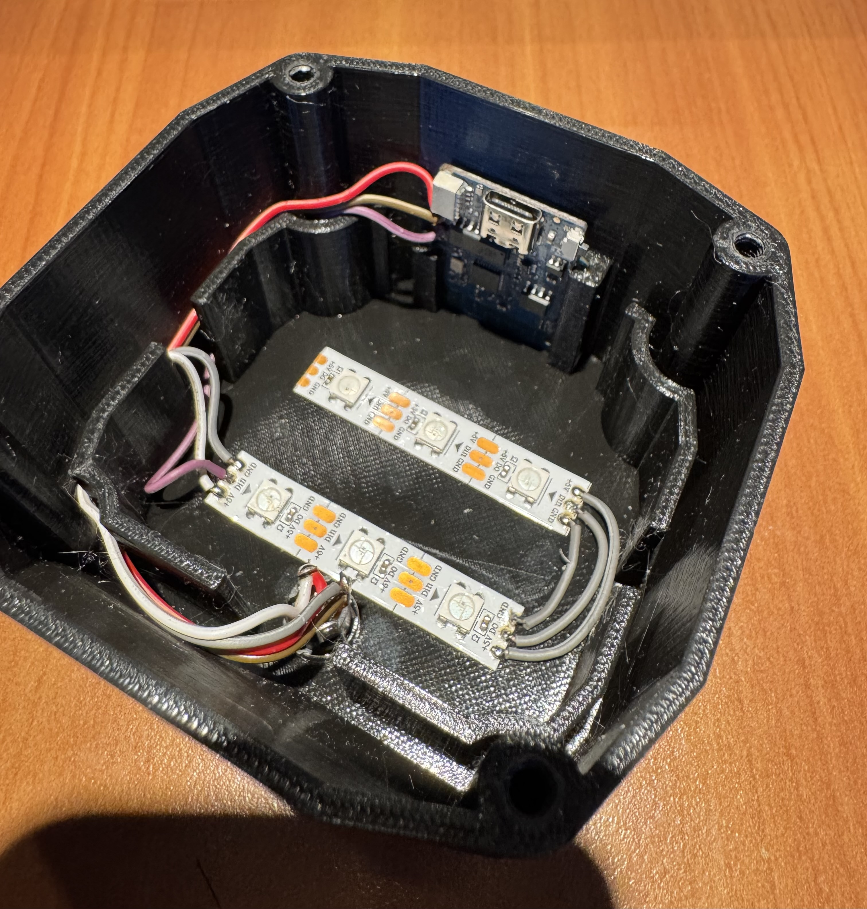

# AZBA Status Indicator

A 3D-printable WiFi-connected LED indicator display for real-time monitoring of AZBA (Airspace Restriction Zone) activation status. This project displays the current and upcoming airspace restrictions for a configurable zone using an ESP8266 microcontroller and addressable RGB LEDs.

**Build one without developer tools:** [azba.ratelet.fr](https://azba.ratelet.fr) (French / English) — parts list, wiring, one-click installation from the browser, and setup from a phone.

**Hardware Model:** [AZBA Status Indicator on Printables](https://www.printables.com/model/1487021-azba-status-indicator-3d-printable-display-for-des)

<div align="center">





</div>

## Features

- **Real-time AZBA Status Display** — Shows if your configured airspace zone is currently active
- **Upcoming Activity Alerts** — Visual indication if the zone will be active within 4 hours
- **LED Status Indicators**
  - 🟢 Green (solid): Zone inactive and not planned to be active
  - 🟡 Yellow (solid): Zone will be active in the future
  - 🟠 Orange (blinking): Zone will be active soon (within 4 hours)
  - 🔴 Red (blinking): Zone active now
  - 🔵 Blue: WiFi connecting
  - 🟣 Purple (slow blinking): Setup portal open, waiting for settings
  - ⚪ White: Error or startup
- 📶 **No compile-time configuration** — WiFi network, AZBA zone and backend URL are entered in a captive portal and stored in flash
- 🌐 **Browser installation** — The firmware is built by GitHub Actions and flashed from Chrome or Edge with [ESP Web Tools](https://esphome.github.io/esp-web-tools/)
- 🔄 **Automatic Refresh** — Fetches AZBA data every 5 minutes
- 🔁 **Auto-Reboot** — Automatically reboots every 48 hours to prevent memory drift
- 🛡️ **WiFi Resilience** — Automatic retry logic (3 retries with 25-second intervals); the setup portal reopens by itself if the saved network stays unreachable
- 🔒 **HTTP or HTTPS backend**

## Hardware Requirements

- **Microcontroller:** Wemos D1 Mini Lite (ESP8266)
- **LEDs:** 6× WS2812B (NeoPixel) addressable RGB LEDs — two pieces of 3 LEDs cut from a 60 LEDs/m strip
- **Power Supply:** 5V/1A adapter with a 5.5 × 2.1 mm plug, panel-mount DC jack socket
- **Screws:** 4× M3
- **3D Enclosure:** See [Printables model](https://www.printables.com/model/1487021-azba-status-indicator-3d-printable-display-for-des)

Wiring: jack + to the board's `5V` pin and the LEDs' `+5V`; jack − to `G` and the LEDs' `GND`; `D4` to `DIN` of the first LED piece, its `DO` to `DIN` of the second.

## Quick Start (no developer tools)

The step-by-step guide, in French and English, is at **[azba.ratelet.fr](https://azba.ratelet.fr)**. In short:

1. **Host the backend** — download `azba-serveur.zip` from the page and upload `azba.php` + `azba_lib.php` to any PHP 8 hosting with cURL (see [API Data Source](#api-data-source)). Check that `https://your-site/azba/azba.php?azba=R149E` returns JSON.
2. **Install the firmware** — plug the D1 mini over USB, open the page in Chrome or Edge on a computer, click **Install**. Tick *Erase device* on the first install only; updates keep the settings.
3. **Configure** — power the device: the LEDs blink purple. Join the `AZBA-Indicator-XXXX` WiFi network from a phone; the setup page opens (otherwise browse to `http://192.168.4.1`). Choose the club's 2.4 GHz network, enter the zone (e.g. `R149E`) and the backend URL, then **Save**. The device reboots, turns blue while connecting, then shows the zone's colour.

### Changing the settings later

- **Double restart:** unplug and plug the device back; as soon as the LEDs turn white, unplug and plug it back a second time (within 10 seconds). Pressing the board's RESET button twice works too. The portal stays open 5 minutes.
- To change only the zone or the backend URL, leave SSID and password empty in the portal: the saved WiFi is kept.
- **Lost network:** if the saved WiFi stays unreachable at boot (3 attempts of 30 seconds), the portal opens for 5 minutes, then the device reboots and tries again. While running, 3 failed reconnection cycles (15 minutes) trigger a reboot into that same path.

### Zone code

Enter the code as shown in the [SIA AZBA application](https://www.sia.aviation-civile.gouv.fr/azbaEx/), without the `LF` prefix (`R149E`, `R45S3`, `R45N5.1`…). The firmware upper-cases it, drops spaces and strips a leading `LF`, and the portal refuses anything that does not look like an AZBA code. A *valid but wrong* code cannot be detected: the backend only lists active zones, so an unknown zone is never found and stays green. Double-check it.

## Building from Source (developers)

- **PlatformIO** (CLI or VS Code extension)
- **PHP 8.0+** with cURL (for the backend and its tests; no Composer needed)
- **Node.js** (only to assemble the web installer site)
- **Dependencies** (auto-installed by PlatformIO): Adafruit NeoPixel, ArduinoJson, WiFiManager

```bash
git clone https://github.com/stephanfo/AZBA-Indicator.git
cd AZBA-Indicator

pio run                              # build the firmware (env d1_mini_lite)
pio run --target upload              # flash over USB
pio device monitor --baud 115200     # serial logs
pio test -e native                   # host unit tests of the zone/URL rules
php tests/run.php                    # backend unit tests
```

There is nothing to configure before building: settings live in the device's flash (LittleFS, `/config.json`; WiFi credentials in the ESP8266 SDK area). Flashing with *erase* resets them.

The firmware version is `<last commit date>-<git describe>` (e.g. `2026.10.21-35f281d`), set by `extra/version.py`; override it with the `FW_VERSION` environment variable. It is printed on the serial port and shown in the portal title.

### Web installer and GitHub Pages

`site/` holds the presentation page (French by default, English toggle) and `site/build.sh` assembles `_site/`: the page, `firmware/firmware.bin` + `firmware/manifest.json` for ESP Web Tools, the ESP Web Tools bundle itself (served locally, no CDN), and `azba-serveur.zip`.

```bash
npm --prefix site ci
./site/build.sh --serve       # http://localhost:8080 (Web Serial also works on localhost)
```

`.github/workflows/pages.yml` runs the unit tests and the same script on every push and pull request touching the firmware, backend or site, and deploys `_site/` to GitHub Pages from `main`. One-time setup: create the DNS record `azba` CNAME `stephanfo.github.io.`; then in the repository settings, **Pages → Source**: *GitHub Actions*, **Custom domain**: `azba.ratelet.fr` (a workflow deployment ignores `site/CNAME`, which only documents the domain and feeds the build checks), and **Enforce HTTPS** — the browser installer only works over HTTPS.

### Configurable Parameters

Edit the constants in `src/main.cpp`:

- `FETCH_INTERVAL_MS` — Refresh interval (default: 300,000 ms = 5 minutes)
- `REBOOT_INTERVAL_MS` — Auto-reboot interval (default: 172,800,000 ms = 48 hours)
- `FETCH_MAX_RETRIES` — Number of retries on failure (default: 3)
- `FETCH_RETRY_INTERVAL_MS` — Delay between retries (default: 25 seconds)
- `WIFI_BOOT_ATTEMPTS` / `WIFI_CONNECT_TIMEOUT_MS` — WiFi attempts at boot before opening the portal (default: 3 × 30 s)
- `PORTAL_TIMEOUT_S` — Portal lifetime when opened on request or after WiFi failures (default: 5 minutes)
- `DOUBLE_RESET_WINDOW_MS` — Window for the double restart (default: 10 seconds)
- `LED_PIN` — GPIO pin for LED strip (default: D4)
- `LED_COUNT` — Number of LEDs (default: 6)

Static IP addressing is no longer supported: use a DHCP reservation on the router.

## LED Behavior

### Status Modes

| Mode | LED Color | Behavior | Meaning |
|------|-----------|----------|---------|
| `MODE_INACTIVE` | Green | Solid | Zone is inactive |
| `MODE_WILL_BE_ACTIVE_LATER` | Yellow | Solid | Zone will be active, but beyond 4 hours |
| `MODE_WILL_BE_ACTIVE_SOON` | Orange | Blinking | Zone will be active within 4 hours |
| `MODE_ACTIVE_NOW` | Red | Blinking | Zone is active right now |
| `MODE_CONNECTING` | Blue | Solid | WiFi is connecting |
| `MODE_CONFIG_PORTAL` | Purple | Slow blinking | Setup portal open (first boot, double restart, or WiFi unreachable) |
| `MODE_ERROR_OR_STARTUP` | White | Solid | Startup or error condition |

## API Data Source

The device does **not** talk to the SIA directly. It calls a small PHP backend
(`php/azba.php`) that you host on your own server; the firmware fetches
`<backend URL>?azba=<ZONE_ID>` and reads three booleans per zone
(`is_active_now`, `will_be_active`, `will_be_active_soon`). The backend URL is
entered in the setup portal; `http://` and `https://` are both accepted (HTTPS
certificates are not verified: no CA store fits in the 1 MB flash, and a pinned
fingerprint would break at every renewal). Enter the `https://` address if your
host redirects HTTP to HTTPS — the firmware does not switch protocols on a
redirect, and such a failure shows as the white ERROR LED.

The backend is split into two files along a clean reuse boundary:

- **`php/azba_lib.php`** — a self-contained, reusable SIA client. It queries the
  **official SIA JSON API** (the same backend the "AZBA2" web app at
  `https://www.sia.aviation-civile.gouv.fr/azbaEx/` uses), decodes it, and
  validates it (fail-safe guards). It returns the **raw extracted data only** —
  the validity interval and each zone's activation time slots:
  - `…/api/v3/custom/currentDate` — the current validity window
  - `…/api/v3/r_t_b_as?…` — the list of active zones with their UTC time slots
- **`php/azba.php`** — the project-specific request handler. It holds this
  product's application logic: the activity flags (`is_active_now` /
  `will_be_active` / `will_be_active_soon`, with the +5 min anticipation and the
  4-hour window), the `?azba=<ZONE_ID>` filter, the metadata counters, and the
  JSON output contract the firmware expects.

> Historically `azba.php` scraped the HTML of `/schedules`. That page is now a
> JavaScript single-page app with no parseable text, so the scraper broke. The
> backend was rewritten to use the structured JSON API above, which is far more
> robust to wording/markup changes. See [CHANGELOG.md](CHANGELOG.md).

### Reusing the library in another project

`php/azba_lib.php` has no dependencies (no Composer). Copy it in, `require` it,
and call `azba_fetch()` to get the raw SIA data; then apply whatever analysis and
output format your project needs. You only write your own handler — never the
SIA querying/extraction.

```php
require 'azba_lib.php';

try {
    $sia = azba_fetch();
    // $sia = [
    //   'interval' => ['start_utc' => '...Z', 'end_utc' => '...Z'],
    //   'zones'    => [ 'R45S3' => ['activations' => [
    //       ['date' => 'YYYY-MM-DD', 'start_utc' => '...Z', 'end_utc' => '...Z'], ...
    //   ]], ... ],   // only zones active in the current window are present
    // ];

    // ...your project's logic: decide what "active/soon" means, format, etc.
    echo json_encode($sia);
} catch (AzbaFetchException $e) {  // SIA unreachable / auth rejected (HTTP code in getCode())
    // handle network failure
} catch (AzbaDataException $e) {   // SIA responded but the data can't be trusted
    // handle contract change — fail visibly, never assume "inactive"
}
```

See `php/azba.php` for a complete handler that turns this raw data into the
firmware's activity flags + JSON. Its `azba_compute_flags()` / `azba_filter_zone()`
/ `azba_build_metadata()` are examples of the per-project layer you would adapt.

To override the API base or shared secret (e.g. after a SIA rotation) without
editing the file, `define('AZBA_API_BASE', …)` / `define('AZBA_SHARE_SECRET', …)`
before the `require`, or pass `apiBase` / `shareSecret` in the `azba_fetch()`
options array.

### Fail-safe design (important)

A *false "inactive"* is dangerous — it could imply a restricted low-altitude
military zone is clear when it is actually active. So `azba.php` **never returns
a "200 OK" it is not confident in**: on any doubt (auth rejected, unexpected
response shape, stale validity window, unparsable times) it returns an HTTP
error, which the firmware shows as the **white ERROR LED** (a visible fault)
rather than silently signalling "clear" (green).

The firmware keeps the same rule for its own settings: without a valid zone and
backend URL it opens the setup portal (purple) instead of guessing, and it
normalizes the zone code exactly like the backend's keys (`lib/AzbaConfig`, unit
tested) so a lower-case or `LF`-prefixed entry cannot silently miss the zone.

### Backend maintenance & tests

The data-integrity guards and the time logic are unit-tested. From the repo root:

```bash
php tests/run.php              # offline, deterministic unit tests
AZBA_LIVE=1 php tests/run.php  # also checks the live SIA API contract
```

If the SIA rotates its API again, the live test fails fast and the header of
`php/azba_lib.php` documents how to re-extract the API base / shared secret from
the web app bundle.

## Project Structure

```
.
├── README.md                      # This file
├── CHANGELOG.md                   # Notable changes per version
├── platformio.ini                 # PlatformIO configuration (firmware + native tests)
├── src/
│   └── main.cpp                   # Firmware: LEDs, setup portal, WiFi, HTTP + JSON
├── lib/
│   └── AzbaConfig/                # Zone / URL normalization (no Arduino dependency)
├── test/
│   └── test_config/               # Host unit tests: pio test -e native
├── extra/
│   └── version.py                 # Stamps the firmware version (git) at build time
├── php/
│   ├── azba.php                   # Example request handler (reads ?azba=, outputs JSON)
│   └── azba_lib.php               # Self-contained, reusable SIA client (azba_fetch)
├── tests/
│   ├── run.php                    # Zero-dependency backend test runner (php tests/run.php)
│   └── fixtures/                  # Captured SIA API responses for offline tests
├── site/
│   ├── index.html, style.css, app.js, assets/   # Presentation page (azba.ratelet.fr)
│   ├── build.sh                   # Builds the firmware and assembles _site/
│   ├── package.json               # ESP Web Tools (vendored into the site)
│   └── CNAME                      # GitHub Pages custom domain
├── .github/workflows/pages.yml    # Tests, build and GitHub Pages deployment
├── cad/
│   ├── fusion360/                 # 3D CAD files (Fusion 360 project)
│   ├── step/                      # STEP format 3D models
│   ├── stl/                       # Printable parts
│   └── images/                    # Product photos and 3D renderings
└── .gitignore                     # Git ignore rules (build artifacts, _site/)
```

## Building the 3D Enclosure

The 3D printable enclosure is available on Printables:
[AZBA Status Indicator Model](https://www.printables.com/model/1487021-azba-status-indicator-3d-printable-display-for-des)

The front shows the zone name: change it in the Fusion 360 file (`cad/fusion360/`) before printing.

**Recommended Settings:**
- **Material:** PLA or PETG
- **Layer Height:** 0.2 mm
- **Infill:** 15–20%
- **Support:** Yes (for LED window)
- **Print Time:** ~4–6 hours
- **Filament:** ~40–50 grams

## Troubleshooting

### The installer finds no device

1. Use Chrome or Edge on a computer (Web Serial is not available on phones, Firefox or Safari)
2. Try another USB cable: charge-only cables carry no data
3. On Windows, install the CH340 driver offered by the install dialog

### Device won't connect to WiFi

1. Make sure the network is 2.4 GHz (the ESP8266 does not support 5 GHz) and the SSID is not hidden
2. Reopen the portal (double restart) and re-enter the network and password
3. Check serial output for error messages: `pio device monitor --baud 115200`

### LEDs not lighting up

1. Verify LED_PIN configuration matches your wiring (default: D4)
2. Check power supply (5V, adequate amperage for all LEDs)
3. Verify WS2812B LED strip is properly connected (GND, 5V, Data) and follows the printed arrows (DIN → DO)
4. Try uploading LED test sketch to verify wiring

### AZBA data not updating

1. Check internet connection: Open serial monitor and look for HTTP errors
2. Verify the zone code in the portal
3. Ensure the backend URL is accessible: open `<backend URL>?azba=<ZONE_ID>` in a browser; use `https://` if your host forces it
4. If the LED is **white (error)**, the backend returned a non-200 — this is the
   intended fail-safe (never a false "inactive"). Hit `azba.php` directly in a
   browser to read the JSON `error` message.
5. Run `AZBA_LIVE=1 php tests/run.php` on the server: if the live test fails, the
   SIA API contract changed and `php/azba.php` needs updating (the file header
   documents how to re-extract the API base / shared secret).

### Device reboots frequently

1. Check power supply stability (use good quality PSU)
2. Verify antenna position on Wemos D1 Mini (avoid metal surfaces around)
3. Increase `REBOOT_INTERVAL_MS` if reboots are too frequent

## Security Notes

- The setup portal is an open WiFi network for as long as it is open (first boot, 5 minutes after a double restart or a WiFi failure). Someone within WiFi range at that moment could change the settings. The portal offers no firmware upload.
- HTTPS backends are contacted without certificate verification (see [API Data Source](#api-data-source)).

## Contributing

Contributions are welcome! Please:

1. Fork the repository
2. Create a feature branch (`git checkout -b feature/your-feature`)
3. Make your changes
4. Test thoroughly on hardware
5. Commit with clear messages
6. Push to your fork
7. Open a Pull Request

## License

This project is licensed under the MIT License — see LICENSE file for details.

## Support & Feedback

- **Issues:** [GitHub Issues](https://github.com/stephanfo/AZBA-Indicator/issues)
- **Printables Model Comments:** [Printables Discussion](https://www.printables.com/model/1487021-azba-status-indicator-3d-printable-display-for-des)

## Acknowledgments

- [Adafruit NeoPixel Library](https://github.com/adafruit/Adafruit_NeoPixel)
- [ArduinoJson Library](https://github.com/bblanchon/ArduinoJson)
- [WiFiManager](https://github.com/tzapu/WiFiManager)
- [ESP Web Tools](https://esphome.github.io/esp-web-tools/)
- [PlatformIO](https://platformio.org/)
- SIA (Service de l'Information Aéronautique) for AZBA data
- Printables community for hardware feedback
